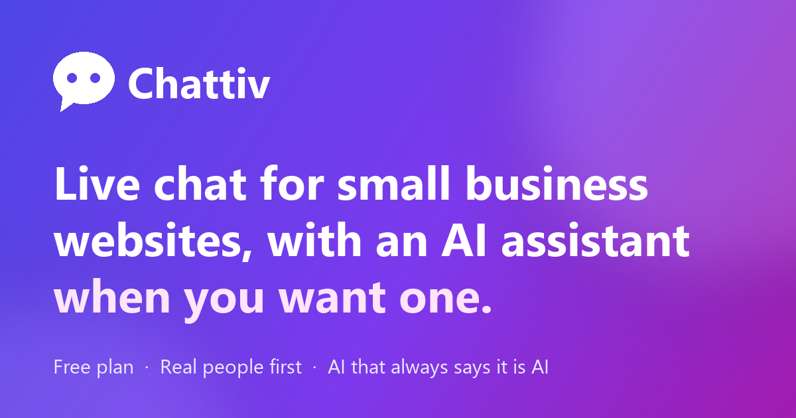
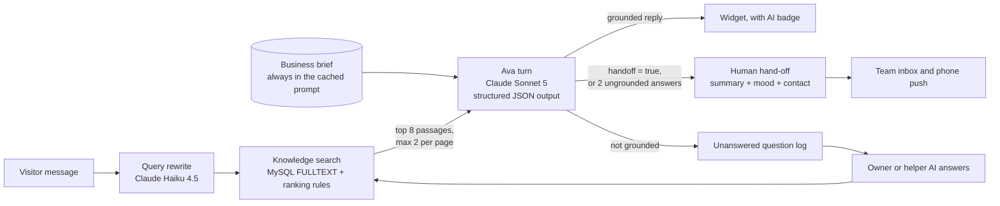
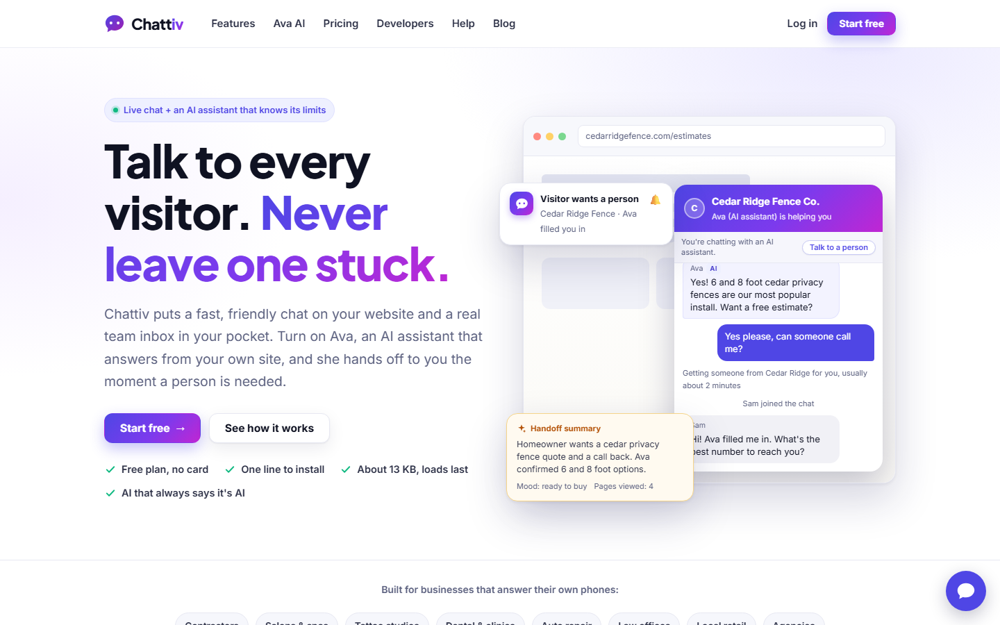
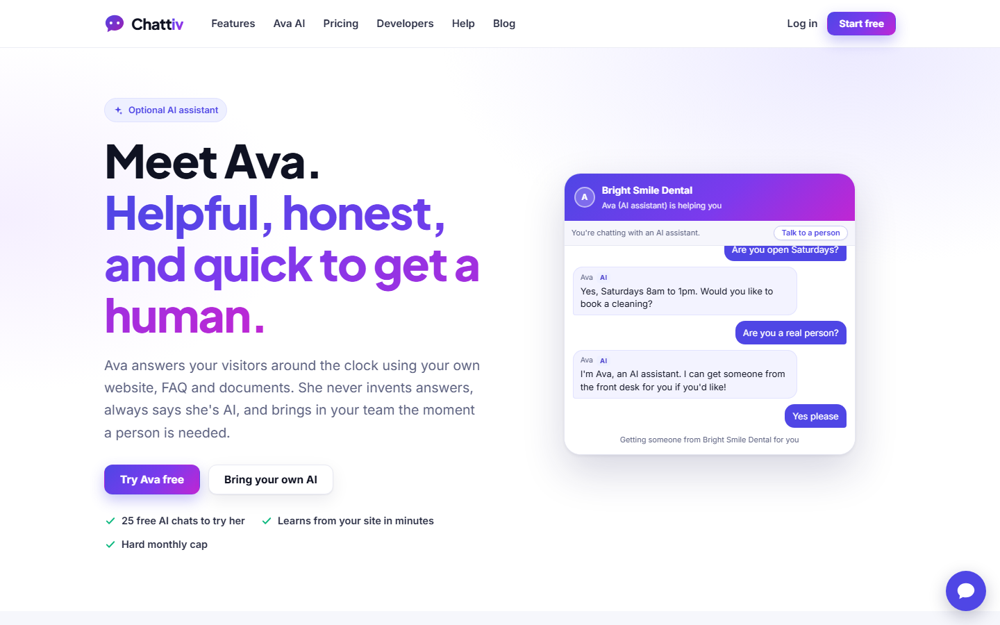
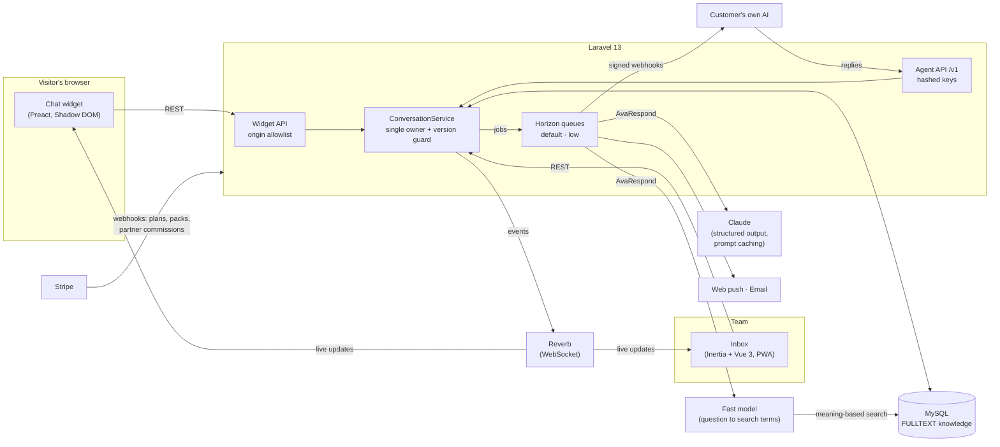
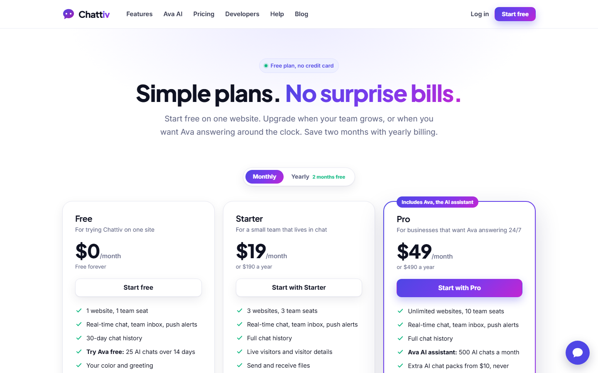
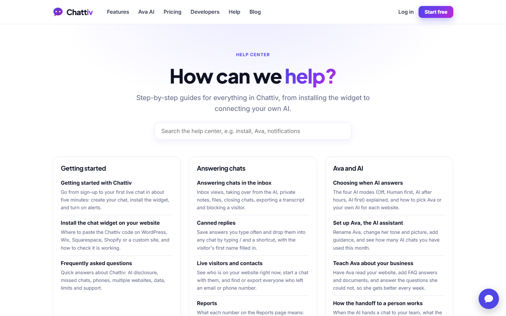
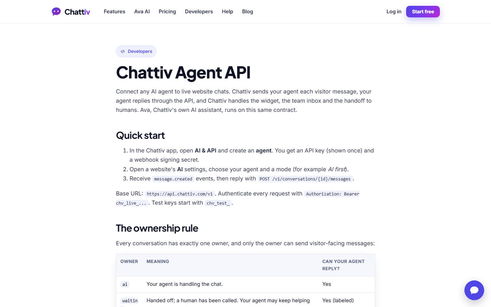
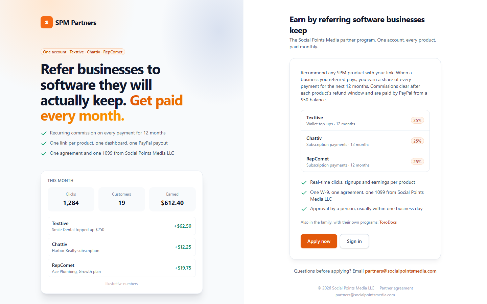

<p align="center">
  
</p>

<h1 align="center">Chattiv: Case Study</h1>

<p align="center">
  <b>Live chat for small business websites, with an AI assistant that knows when to step aside.</b><br>
  Laravel 13 · PHP 8.3 · Claude Sonnet 5 + Haiku 4.5 (Anthropic API) · MySQL · Redis + Horizon · Reverb · Stripe · Vue 3 · Preact
</p>

---

Most website chat tools fail small businesses in one of two ways: the chat goes unanswered, or a bot traps the
visitor in a loop with no way to reach a person. Chattiv is built around the opposite promise. People answer by
default. The AI assistant is optional, answers only from the business's own content, always says it is an AI, and
hands the conversation to a human the moment one is needed, with a summary so the visitor never repeats themselves.

This repository is a **portfolio case study**: a public overview of the product, architecture and engineering. The
full application source is private and available to reviewers on request.

> **Status:** live in production at [chattiv.com](https://chattiv.com), running chat on its own site and on
> several other SaaS products in the same portfolio.

---

## AI at the core: how Ava works

Ava is Chattiv's built-in AI assistant. She is **opt-in per website** and **human-first by design**: a business turns
her on as backup when nobody picks up, for after-hours only, or as the first responder, and every mode hands the chat
to a person the moment one is needed. The interesting work is not "call a model": it is everything around the call
that makes the answers trustworthy, measurable and cheap.



### The model call

- **Models.** Each visitor turn runs on **Claude Sonnet 5** through the Anthropic API (official PHP SDK) at low
  effort, which suits short live-chat replies. A small, fast model (**Claude Haiku 4.5**) handles the helper step of
  rewriting the visitor's question into search terms.
- **Structured output, not free text.** Every turn returns a JSON object validated against a schema: `reply`,
  `grounded`, `handoff`, `handoff_reason`, `summary`, `mood` and `contact`. The application, not the model, decides
  what happens next: whether to send the reply, open a hand-off, log a knowledge gap or save the visitor's details.
- **Prompt caching.** The stable part of the prompt (persona, rules and the business brief) is marked for caching, so
  only the transcript and the retrieved passages change from turn to turn.

### Grounding: answers come from the business, not the model

- **Sources.** Each website's knowledge is its own crawled pages (re-crawled weekly), FAQ answers the owner writes,
  and uploaded documents. Text is split into paragraph-aligned chunks of up to 1,200 characters.
- **Retrieval.** MySQL FULLTEXT search, deliberately no vector database to run. Keyword search alone failed in a
  telling way: asked "what makes your service better than other services?", the word "service" pulled five chunks of
  a Terms of Service page while the site's comparison articles never surfaced. So the fast model first rewrites the
  question into what the visitor means ("comparison, alternative, versus, competitors") and flags whether it is a
  legal question; legal and template pages are then demoted unless the question is about them, and no single page
  may take more than two of the eight passage slots. Replaying the same question afterwards returned the comparison
  pages and a grounded answer.
- **The business brief.** A company overview of up to 8,000 characters rides in the cached prompt on every turn, so
  broad questions ("what do you do?", "why you?") never depend on search.
- **Ava interviews the owner.** After a crawl, one call reviews everything Ava knows, drafts the brief, and lists the
  questions customers of that kind of business usually ask that the site never answers. Guesses are shown as
  guesses and only become knowledge once a person confirms them.
- **A learning loop without training.** Every question Ava could not ground is logged per website. The owner types an
  answer once ("Teach Ava"), it is indexed as knowledge, and it is used on the very next message. Nothing is
  fine-tuned; the knowledge base is the single source of truth, so a corrected fact is corrected everywhere at once.

### Guardrails

- **Honest by construction.** Ava always says she is an AI, never claims or implies she is human, and every AI message
  carries an AI badge the business cannot switch off. A "Talk to a person" button is always visible.
- **No invention.** She answers only from the brief, the retrieved knowledge and the conversation. She never invents
  prices, policies, hours, availability or promises; when the knowledge does not cover a question she says so and
  offers a person. She gives no medical, legal or financial advice and never asks for passwords or card numbers.
- **Escalation rules.** She hands off when the visitor asks for a person, is frustrated, or needs something only staff
  can do (refunds, custom quotes, account changes, complaints), or when the topic is on the business's own hand-off
  list. Independently of the model, two ungrounded answers in one chat hand it to the team. The hand-off carries a
  summary, the visitor's mood and any contact details, so the visitor never repeats themselves.
- **One owner per conversation.** The AI and a person can never talk over each other: ownership is enforced on the
  server, and a person replying always takes the chat from the AI.
- **What Ava can read is curated.** Private pages are kept out of her knowledge entirely. For example, the
  invite-only tester sign-up page is left out of the sitemap, the help center and every source Ava reads, and that
  is verified rather than assumed, so she cannot hand the link to a visitor.

### Bring your own AI

- **Agent API.** A business can connect its own AI to answer chats directly, under exactly the same hand-off rules:
  signed webhooks (HMAC-SHA256), a 30-second reply deadline, and an automatic fall-back to the team.
- **Helper agents.** Many businesses already have an AI that knows them well but was built for email, not a live chat
  that needs an answer in seconds. A connected AI can instead be **Ava's helper**: it receives every question Ava
  could not answer and its answers become her knowledge, it can write the business brief and sync FAQ entries, and,
  optionally, Ava asks it live ("let me check on that for you") with a wait window of up to three minutes before
  falling back to a person. An AI without a public endpoint can do all of this by polling.
- **Partner products.** Another product in the portfolio (RepComet, a review tool) includes Chattiv for its
  customers: it creates accounts through a signed partner API and signs its users in with single sign-on. Ava follows
  the same trial and plan rules for those accounts.

### Measured and controlled

- **Metering.** An AI chat is counted once, the first time Ava replies in a conversation, however many messages
  follow. Usage is metered per account per month, and the input and output tokens of every Ava reply, knowledge
  review and conversation summary are recorded, which feeds a per-account AI cost estimate in the operator panel.
- **A hard cap, then a choice.** Pro includes 500 AI chats a month. When they run out, new chats go to the team (they
  are never dropped) unless the owner adds a pack that never expires (100 for $10, 500 for $40, 1,000 for $70), or
  turns on an auto top-up that stays within a monthly spending limit they set and pauses itself if a payment fails.
- **A trial that can't run up a bill.** Free and Starter accounts get 25 AI chats within 14 days of signing up, once
  per account.
- **Rate limits.** The widget allows 30 messages a minute per visitor (and 120 per address), and the Agent API 600
  requests a minute per key.
- **Knowledge quality is maintained, not set once.** Weekly re-crawls keep site content current; when a plan changed
  (the Ava trial was extended to Starter), the FAQ answer that said otherwise was corrected the same day so Ava would
  not repeat a stale fact; and a sync bug that once removed the help articles Ava answers from was caught and fixed.
- **Early production footprint.** Chattiv is weeks into production, so there are no volume benchmarks to quote yet.
  What exists today: 214 knowledge sources indexed into 819 chunks across the live websites.
- **Tested.** AI behavior runs against a fake client in tests, so every rule is checked without calling the model:
  six AI-focused test files (conversation flow and hand-off, the Agent API, helper agents, knowledge search ranking,
  the knowledge gap check, and AI packs and top-ups) hold 49 tests, inside a suite of 200.

### What it costs the business

| Product | Price of an AI-answered chat | Source (checked 2026-10-19) |
|---|---|---|
| **Chattiv** | **$0.07 to $0.10** (packs of 1,000 for $70 to 100 for $10), plus 500 a month included on Pro | [chattiv.com/pricing](https://chattiv.com/pricing) |
| Tidio (Lyro) | about $0.65 (from $32.50 for 50 conversations) | [tidio.com/pricing](https://www.tidio.com/pricing/) |
| LiveChat | about $0.99 (50 extra AI resolutions for $49.50) | [livechat.com/pricing](https://www.livechat.com/pricing/) |
| Intercom (Fin) | $0.99 per outcome | [intercom.com/pricing](https://www.intercom.com/pricing) |

Competitor prices are list prices as published on the date shown and may change. The low price is a product of the
design above: a cached prompt, a small model for the cheap helper step, and retrieval that sends only a few relevant
passages instead of the whole site.

---

## The product

<p align="center">
  
</p>

| | |
|---|---|
| **Chat widget** | One script tag. About 13 KB, isolated in a Shadow DOM, loads after the host page is idle. Brand color, greeting, offline form, file sharing, ratings, transcript by email. |
| **WordPress plugin** | Install from WordPress, click Connect to Chattiv, sign in, pick the website, and the chat is live. No code to copy. |
| **Team inbox** | Real-time inbox with views (waiting, mine, AI, unread), take over and hand back, private notes, canned replies, live visitor details, light and dark mode. Installable as a phone app with push alerts. |
| **Ava, the AI assistant** | Opt-in per website: off, human first with AI backup, AI after hours, or AI first. Learns from the site, a business brief, FAQ answers and documents, and from the questions she could not answer. Finds answers by meaning, not just matching words. |
| **Agent API** | Businesses can connect their own AI. It can answer chats directly under exactly the same handoff rules, or act as **Ava's helper**: teaching her and answering live when she doesn't know. Webhooks, WebSocket or simple polling. |
| **Billing** | Free, Starter and Pro plans with Stripe, a 25-chat Ava trial on Free and Starter so every new business meets the AI before paying for it, plus AI chat packs that never expire and an optional auto top-up with a monthly cap. |
| **Partner referrals** | Chattiv plugs into the shared SPM Partners program, where people who don't use it can promote it alongside the other products. Chattiv tracks their links and reports sign-ups and payments; the hub handles applications, commissions and payouts. |
| **Tester program** | A capped sign-up page with a waitlist gives a few businesses Pro free for 60 days (a month to learn it, a month to use it for real) in exchange for honest feedback, with automated check-ins and an operator view of real usage. |
| **Help center** | One set of articles shown in the app, on the public site, and used by Ava to answer customers' "how do I" questions. |

<p align="center">
  
</p>

---

## Architecture



One Laravel application serves the marketing site, the app, the Agent API and the widget API on separate hosts.
Laravel Reverb pushes every change to the inbox and the widget in real time. Horizon runs two queues so a long website
crawl can never delay a chat reply.

---

## Engineering highlights

### 1. One owner per conversation, enforced on the server

The core rule of the product is that the AI and a person never talk over each other. Every conversation has exactly
one owner (`ai`, `waiting`, `human`, `team`), and every transition goes through one service that bumps a version
number. A reply from the AI that arrives after a person took over is rejected rather than shown.

```php
// Simplified: a transition only succeeds against the version the caller saw.
$updated = Conversation::whereKey($c->id)
    ->where('owner_version', $c->owner_version)
    ->update(['owner' => $to, 'owner_version' => $c->owner_version + 1]);

if (! $updated) {
    throw new OwnershipConflict();   // someone else moved first
}
```

The handoff triggers are deliberately conservative: the visitor asks for a person (an always-visible button, or plain
words like "real person"), mentions a topic the business marked as human-only, gets two answers the AI could not
ground in the business's content, or the AI errors or misses a 30-second deadline. While the visitor waits, the AI
keeps helping, clearly labeled, and the team receives a short summary with a mood tag.

### 2. An AI that is honest by construction

Covered in depth in [AI at the core: how Ava works](#ai-at-the-core-how-ava-works): structured output so the
application decides what happens next, retrieval with meaning-aware query rewriting, a cached business brief,
locked AI disclosure, escalation rules and metered, capped usage.

### 3. A widget that is a good guest

The widget is the only code Chattiv runs on someone else's website, so it is built to be invisible until wanted:

- Preact and TypeScript bundled by esbuild into one file of about 13 KB gzipped, loaded only after the host page has
  finished and the browser is idle.
- Rendered inside a Shadow DOM so the host's CSS cannot break it and it cannot break the host.
- A minimal hand-written Pusher-protocol client for real-time updates instead of a client library.
- Every request is checked against the website's allowed domains, so a copied snippet does not work elsewhere.

Since roughly four in ten websites run WordPress, the widget also ships as a **WordPress plugin** with a one-click
connect instead of a snippet:

- The plugin sends the owner to Chattiv with its address and a one-time state token. Chattiv accepts the request only
  if the return address is the same site's `wp-admin`, so the flow can't be used as an open redirect. The owner signs
  in (new users onboard with the form already filled in), picks or creates the website, and is sent back with the
  site's public key. The plugin checks the state before saving anything.
- Chattiv adds the WordPress address to the website's allowed domains during that round trip, so the chat works the
  moment the owner lands back in WordPress, and the settings page asks Chattiv whether the chat is allowed on the
  site to catch misconfiguration.
- On the front end it is one async script tag through WordPress's own enqueue API, with options to hide the chat by
  content type or page and, opt-in only, to pass a signed-in user's name and email.
- It was tested in a real WordPress 7.1 running in the browser (WordPress Playground, installed straight from the
  app's download link) and passes WordPress.org's official Plugin Check with no errors.

### 4. Bring your own AI, same rules

The Agent API lets a business plug in any AI. Keys are stored hashed and shown once. Webhooks are signed with
HMAC-SHA256 over the timestamp and body, retried with backoff, and logged with response codes so developers can
debug without asking support. External agents get a 30-second reply deadline, after which the chat falls back to
the team automatically.

```text
X-Chattiv-Signature: sha256=<hex HMAC-SHA256(secret, "{timestamp}.{raw body}")>
```

Webhook targets and crawl URLs are validated against private and reserved networks to prevent server-side request
forgery.

The first real integration taught a lesson: many businesses already have an AI that knows them well, but it was
built for email, not for replying in a live chat within seconds. So the API gained a second role. A connected AI can
be **Ava's helper** instead of the voice on the chat: it receives every question Ava couldn't answer and its answers
become her knowledge, it can write the business brief and sync FAQ entries idempotently by its own ids, and,
optionally, Ava can ask it live ("let me check on that for you") with a wait window of up to three minutes before
falling back to a person. An AI without a public endpoint can do all of this by polling, no tunnel required.

### 5. Never miss a chat

Chattiv treats "nobody answered" as a design problem, not an edge case:

- Web push (VAPID) to an installable PWA, so alerts reach phones even when the inbox is closed, plus an in-app
  doorbell sound for the moments that matter.
- A configurable wait window. If nobody answers in time, the AI covers (when enabled) or the visitor is offered an
  email follow-up, and the team's reply is emailed to them, branded as the business.
- Time zones handled end to end: stored in UTC, shown in the reader's own zone, with business hours evaluated in
  each website's zone.

### 6. Billing that cannot surprise anyone

Stripe through Laravel Cashier, attached to the account rather than the user so a team shares one subscription.
AI usage is the only metered cost, so it has a hard monthly cap. Extra AI chat packs never expire, and optional auto
top-up runs only within a monthly spending limit the owner sets, pausing itself if a payment fails.

### 7. Deleting data properly

Privacy promises are only as good as the delete button behind them, so both kinds of deletion are real features
rather than support tickets:

- **A visitor's data** ("please delete my information", for example under GDPR): an owner or admin removes the
  visitor from Contacts or from the chat, and every conversation, message, page view and contact detail goes with
  them. Files they sent are removed from disk too, not just unlinked in the database.
- **A whole business account**: the owner types the account name and their password in a Danger zone. Billing is
  cancelled first, and if Stripe can't cancel, nothing is deleted, so nobody can keep paying for an account that no
  longer exists. Then one transaction removes the account, and foreign-key cascades take every website, chat,
  contact, knowledge source, AI agent, API key and team membership with it, followed by the files on disk. Nightly
  backups age out within 14 days, which is exactly what the privacy policy and DPA say.

### 8. A tester program that can't buy reviews

Early feedback from real businesses matters more than early reviews, and the program is built so the two can never
be traded for each other:

- **Spots that bots can't take.** Applying never holds a spot. A spot is taken only when a person confirms their
  email and finishes setting up a business, and that count and update run under a row lock, so two businesses
  finishing at the same moment can't both take the last one. The form itself has a honeypot, an encrypted fill-time
  check and a per-address daily cap, and a blocked sender sees an ordinary success page, so it learns nothing. Each
  tester route has its own rate-limit bucket, so a tester clicking their links can't lock themselves out of applying.
  Every applicant agrees to versioned feedback terms, stored with the version and time. The page is invite only and
  kept out of search, the sitemap and the AI assistant's knowledge.
- **Feedback, not a review, is the deal.** A free period starts when the business claims its emailed link (straight
  away if they're signed in, or carried through sign-up and applied at onboarding). Hourly, a scheduled job sends
  check-ins on days 3, 14, 30 and 45 and at the end, most with a two-minute form, then ends the period. Each goes
  exactly once; if the job was ever paused, only the latest due check-in is sent, so nobody gets a burst of stale mail. The account
  goes back to its normal plan, never below a plan someone is paying for, and keeps all of its data.
- **No review gating.** The optional review request goes to every tester at the end, whatever their feedback said,
  and states that it is optional, should be honest, and should disclose the free access. A test asserts a tester who
  rated Chattiv 1 out of 5 still gets the identical request.
- **Real usage for the operator.** The admin view measures what testers actually did (sign-ins, last activity, chats
  answered by people and by the AI, whether the chat is live on their site) and flags anyone who has gone quiet, so
  a nudge goes to the right business at the right time.

### 9. Running it in production

- **A health check monitors can trust.** `/health` on the app and API hosts checks the database, Redis, the queue
  worker (a tiny job queued every minute must actually run), the scheduler (a tick written every minute), storage
  and the websocket server, all in a few milliseconds. Anonymous callers see only `ok` or `fail` (200 or 503); the
  per-check detail needs a token compared in constant time. It runs outside the session middleware, so a monitor
  never creates sessions or cookies.
- **Owner alerts, once per event.** New sign-ups (including accounts a partner creates through its API), paid
  subscriptions starting or being cancelled, AI trials and confirmed testers email the owner. Each event writes a
  unique key first, so a retried Stripe webhook or a double click can't send twice; alerts are queued so they never
  slow a sign-up, skip staff and test data, carry no secrets, and the address lives only in server configuration.

### 10. Plugging into a shared partner program

Chattiv's referral program started as a self-contained feature inside the app. Once SocialPoints Media had several
products with referral programs, it moved to one shared hub (one partner account, one agreement, one payout across
every product), and Chattiv became a client of that hub. The product kept only what it is best placed to do:

- **Attribution.** `?ref=code` on any page, or a `chattiv.com/r/code` short link, is remembered for 90 days in a cookie
  scoped to the parent domain, so a click on the marketing site is still known when the visitor signs up on the app
  host. The last link clicked wins, and the code is credited to the business account at onboarding.
- **Money events, reported from Stripe.** A listener on the Stripe webhook turns every charge on a referred account
  into a `payment` event for the hub (plans and AI packs alike), `charge.refunded` into a `refund` for only the newly
  refunded part, and disputes into a `chargeback` that points at the charge it undoes. Customers of other apps on the
  shared Stripe account are ignored.
- **Safe delivery.** Each event carries a stable external id (`charge:{id}`, `refund:{id}:{running total}`), so the hub
  can de-duplicate and a queued job can retry freely; malformed events are dropped instead of retried forever. A
  partner-program outage can never make Stripe re-deliver a webhook or slow down the app.

---

## More of the product

<p align="center">
  
</p>

<p align="center">
  
</p>

<p align="center">
  
</p>

<p align="center">
  
</p>

---

## Quality and safety

- A feature test suite of 200 tests covering ownership and handoff, AI escalation, helper agents, knowledge search
  ranking, the offline path, widget origin checks, the Agent API and webhook signing, plan limits, billing and
  top-ups, data deletion, the tester program, owner alerts, the health check, the knowledge gap check, partner attribution and reporting, emails, time zones and the help center.
- The test bootstrap refuses to run against anything but an in-memory database, so a test run can never touch
  production data.
- Continuous integration on every push: GitHub Actions installs from the lock file with strict `npm ci` on the same
  Node version as production, builds the app and the widget, and runs the full suite. Wiring it up surfaced a real
  packaging bug (an export rule that silently dropped the branded email templates), which is the point of having it.
- Dependencies are audited and kept clean. The only advisories ever reported were in build-time tooling (a formatter's
  worker pool and a dev process runner), never in code that reaches the browser or the server runtime; they were
  patched anyway, and `npm audit` reports zero.
- Accessibility and performance by default: keyboard support in the widget, reduced-motion support, and no work on
  the host page until it has loaded.

## Tech stack

**Backend:** PHP 8.3, Laravel 13, MySQL 8, Redis, Horizon, Reverb, Cashier (Stripe), Fortify (2FA and passkeys),
Anthropic PHP SDK (Claude).
**Frontend:** Inertia 3, Vue 3, TypeScript, Tailwind CSS. **Widget:** Preact, TypeScript, esbuild.

---

<p align="center">
  Chattiv is a product of SocialPoints Media LLC. Source available to reviewers on request.
</p>
